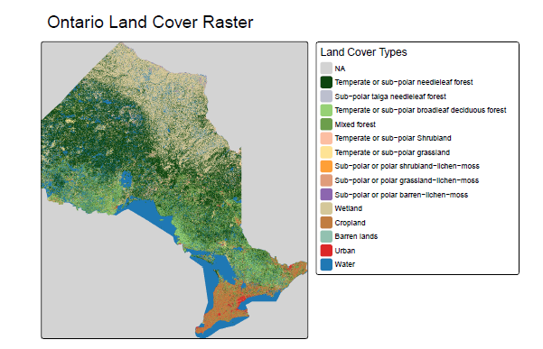
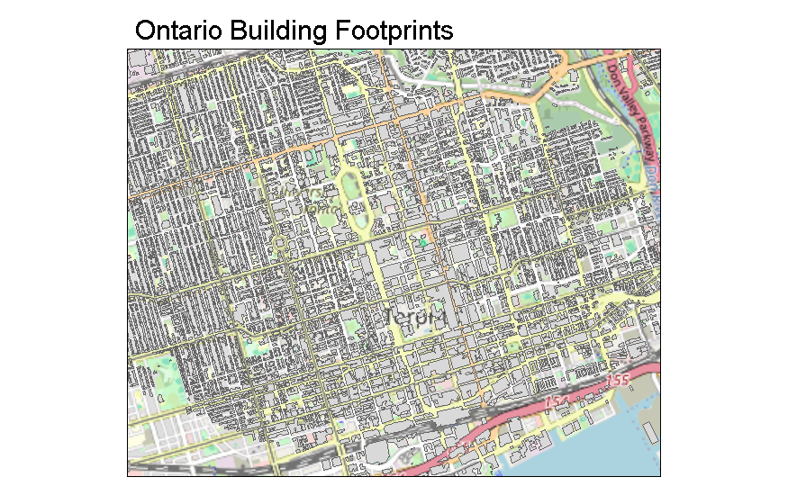
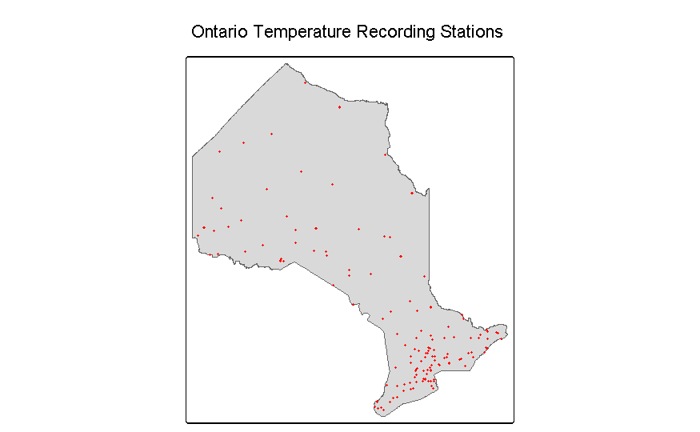
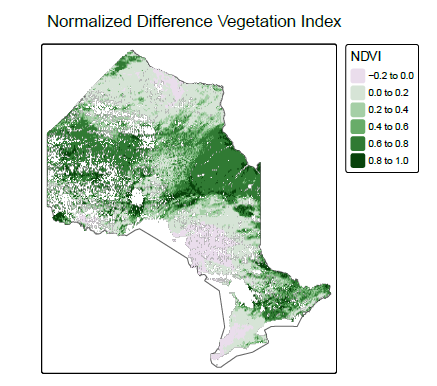

# Spatial-Temporal Modeling and Machine Learning Prediction of the Urban Heat Island Effect in Ontario

[](Urban_Heat_Island_Ontario.pdf)
[](proj.Rmd)
[](Urban_Heat_Island_Ontario.html)
[](#)
[](https://opensource.org/licenses/MIT)

**Author:** Niraj Pradipkumar Patil  
**Date:** July 2024  
**Domain:** Geospatial Data Science, Environmental Remote Sensing, Spatial Statistics & Machine Learning  

---

## 📄 Direct Portfolio Deliverables

For instant recruiter review without requiring an active RStudio or R runtime:

| Deliverable | File Link | Description |
| :--- | :--- | :--- |
| **Complete PDF Report** | [**`Urban_Heat_Island_Ontario.pdf`**](Urban_Heat_Island_Ontario.pdf) | **13-page publication-grade PDF report** with embedded maps, mathematical formulations, model benchmark tables, and policy recommendations. Natively viewable on GitHub! |
| **Interactive Web Report** | [**`Urban_Heat_Island_Ontario.html`**](Urban_Heat_Island_Ontario.html) | Standalone interactive HTML report with syntax-highlighted code blocks, tables, and cartography. |
| **R Markdown Source** | [**`proj.Rmd`**](proj.Rmd) / [**`Urban_Heat_Island_Ontario.Rmd`**](Urban_Heat_Island_Ontario.Rmd) | Production-grade R Markdown workflow configured with `eval = FALSE` for rapid code inspection. |
| **Academic Bibliography** | [**`references.bib`**](references.bib) | Formal BibTeX references covering satellite datasets and peer-reviewed spatial statistical literature. |

---

## 📌 Executive Overview

Urban Heat Islands (UHIs) are metropolitan microclimates that experience significantly elevated surface and air temperatures relative to surrounding rural landscapes. In Ontario, Canada—spanning dense urban centers across the Greater Golden Horseshoe to sub-polar northern ecosystems—extreme summer heat amplifies energy consumption, increases air pollution emissions, and poses acute public health risks.

This repository contains the complete spatial data science architecture and empirical modeling pipeline to quantify, model, and predict the **Heat Island Effect (HIE) Index** across Ontario using high-resolution raster classifications, satellite remote sensing, polygon building footprints, ground weather stations, and census demographics.

---

## 🔍 Key Highlights & Methodological Innovations

1. **Multimodal Geospatial Harmonization**:
   - Integrates 30m Land Cover rasters (Canada Centre for Remote Sensing), NOAA-20 VIIRS 16-day composite NDVI NetCDF arrays with Quality Assurance (QA) bitmask filtering, Microsoft Open Building Footprints, and 187 Environment Canada ground weather stations.
2. **Quantitative HIE Index Derivation**:
   - Formulates a multiscale annular buffer algorithm ($\Delta T = T_{\text{local}} - \bar{T}_{\text{rural}}$) to isolate localized microclimatic thermal anomalies from macro-scale latitudinal and elevation climate baselines.
3. **Continuous Surface Spatial Interpolation**:
   - Implements **Inverse Distance Weighting (IDW)** ($p = 2$) and geostatistical surface interpolation to generalize point observations into provincial-scale thermal layers.
4. **Spatial Autocorrelation Diagnostics**:
   - Diagnoses spatial dependence using row-standardized spatial weights matrices ($W$) and Monte Carlo simulated **Global Moran's $I$** ($p < 0.001$).
   - Pinpoints thermal hotspots and coldspots using **Local Indicators of Spatial Association (LISA)**.
5. **Mitigating Spatial Overfitting with Spatial Cross-Validation**:
   - Employs coordinate-based spatial block resampling (`mlr3spatiotempcv::rsmp("spcv_coords")`) to eliminate spatial autocorrelation data leakage.
   - Benchmarks **Regularized Elastic Net (`glmnet`)**, **Spatial Random Forest (`ranger`)**, and **Weighted $k$-NN (`kknn`)** with permutation feature importance.

---

## 📊 Cartographic Visualizations

<p align="center">
  
  
</p>
<p align="center">
  <em>Figure: (Left) 30m CCRS Land Cover Classification across Ontario. (Right) Microsoft Building Footprint Density.</em>
</p>

<p align="center">
  
  
</p>
<p align="center">
  <em>Figure: (Left) 187 ECCC Ground Weather Monitoring Stations. (Right) Satellite-derived NDVI Vegetation Vitality.</em>
</p>

---

## 📂 Repository Structure

```text
├── Urban_Heat_Island_Ontario.pdf  # 13-Page Full Publication PDF Report (Instant GitHub Preview)
├── proj.pdf                       # Canonical copy of the PDF report
├── Urban_Heat_Island_Ontario.html # Standalone interactive HTML report
├── proj.html                      # Canonical copy of the HTML report
├── proj.Rmd                       # Primary portfolio R Markdown notebook
├── Urban_Heat_Island_Ontario.Rmd  # Descriptive named copy of the R Markdown notebook
├── references.bib                 # Comprehensive academic and data provenance bibliography
├── README.md                      # Project documentation and portfolio overview
├── figures/                       # Extracted cartographic maps and visualizations
├── Land_cover/                    # 30m Land Cover geospatial raster assets (CCRS)
└── Presentation/                  # Project presentation slides and visual assets
```

---

## 🚀 Key Libraries & Technologies

- **Spatial Geometries & Rasters**: `sf`, `terra`, `stars`, `osmdata`
- **Cartography & Visualization**: `tmap`, `ggplot2`, `scales`, `viridis`
- **Spatial Statistics & Interpolation**: `spdep`, `gstat`
- **Predictive Machine Learning**: `mlr3`, `mlr3spatiotempcv`, `mlr3learners`, `mlr3tuning`, `paradox`, `glmnet`, `ranger`, `kknn`

---

## ⚙️ Note on Reproducibility & Code Execution

In both [`proj.Rmd`](proj.Rmd) and [`Urban_Heat_Island_Ontario.Rmd`](Urban_Heat_Island_Ontario.Rmd), code chunk execution is configured with `eval = FALSE` by design:

```r
knitr::opts_chunk$set(
  eval = FALSE,
  echo = TRUE,
  warning = FALSE,
  message = FALSE
)
```

Because this research utilizes multi-gigabyte spatial rasters (30m land cover grid, province-wide building polygons, multidimensional satellite NetCDF arrays), running the full compute pipeline requires substantial RAM and high-performance computing resources. Disabling evaluation ensures instant, lightweight inspection of code logic, statistical formulations, and cartographic pipelines directly on GitHub.

---

## 📜 Citation & References

All data sources and foundational methodological references (e.g., Oke 1982, Voogt & Oke 2003, Moran 1950, Brenning 2012) are formally cataloged in [`references.bib`](references.bib).
